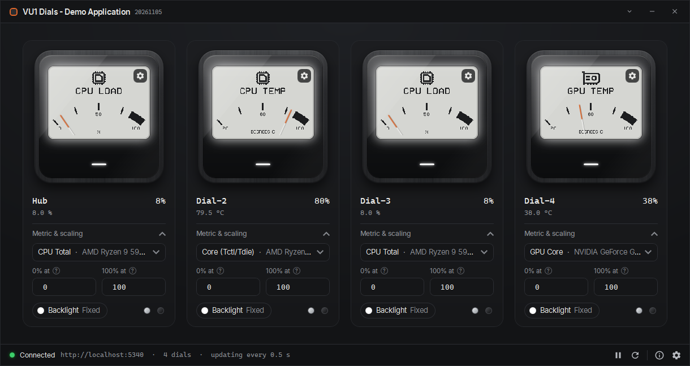

# Demo Application for VU1 Dials

## How to use

In order to run the VU1 Demo Application you will need

- VU1 Server configured and running ([VU1 Repository](https://github.com/SasaKaranovic/VU-Server))
- At least 1 or more VU1 dials connected to your PC (your VU1 server if using remotely)

Simply download the demo app from [releases page](https://github.com/SasaKaranovic/VU-Demo-App/releases) and run the `VU1-Demo-App.exe`

Please note that this is a Demo application that shows one of many different ways VU1 dials could be used.

## Documentation

VU1 documentation can be found at https://docs.vudials.com

## More information

You can find more information about the VU1 dials at https://vudials.com

## About

VU1 Dials are designed and developed by [Karanovic Research](https://karanovicresearch.com) and [Streacom](https://streacom.com)
